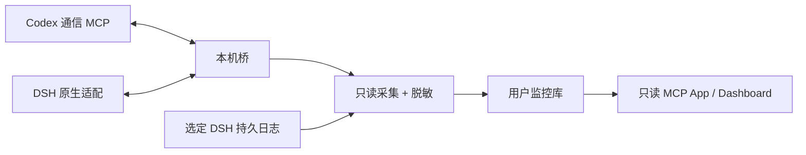

# 桥间 · GPT × DSH

本地运行的双向协作桥与只读通信监控。会话视图展示实际采集到的消息、任务、子会话和明确声明的文件，提供右侧定位导航、文件预览、健康容量、备份恢复与迁移。

**预览版本：0.7.0-beta.1。首发目标为 Windows + Codex + DSH，同一电脑一组协作。** 项目自有代码采用 MIT；第三方依赖保留原许可，见 [许可声明](THIRD-PARTY-NOTICES.md)。本仓库包含预构建运行文件，使用者需要 Node.js 24.12+，无需 npm install。源码构建另需安装锁定开发依赖。

| 组件 | 安装位置 | 权限与职责 |
|---|---|---|
| 桥间 monitor | Codex 插件 / 支持的 MCP 客户端 | 只读查询已脱敏监控库和允许目录内文件 |
| collector + Dashboard | 本机一份后台进程 | 只读采集来源，脱敏后写独立 SQLite |
| 可选 bridge MCP | Codex 客户端 | 消息、任务、共同记录；执行唤醒另行开启 |
| 可选 DSH 原生适配 | DSH profile | 工具与入站 followup，自动 followup 另行开启 |

只读 monitor 不向原桥发消息或确认已读，不授予任务执行能力。单独查看监控需要已有受支持的来源及运行中的采集器。需要双向协作时配置两端适配，共享同一桥。首次配置使用用户自己的新数据目录，不携带开发者聊天、数据库、Token或真实截图。

状态含义：saved为已保存；delivered为客户端通过HTTP取到消息；read为客户端显式确认；replied为存在关联回复。它们不等同于任务完成或用户验收。



## 五分钟试用：合成演示

解压 Release，在本目录用 PowerShell 执行：

```powershell
node bin/bridge-between.mjs setup --demo
node bin/bridge-between.mjs start --background
node bin/bridge-between.mjs doctor --mcp
```

打开 start 输出的本地地址，可看到两条明确标为合成演示的消息和一个示例文件。默认从47832开始有界探测可用端口；已有服务占用时会选下一个可用端口，显式指定占用端口会报错。`doctor` 分别报告 collector、MCP 和 UI：UI `not_verified` 表示没有验证宿主实际显示，不是网络错误。演示使用新目录；已有正式配置请使用 `--home` 指定另一个新目录。setup拒绝用户目录根部和卷根作为数据home。

完整接入见 [安装指南](docs/INSTALL.md)，客户端能力和未验证项见 [兼容说明](docs/COMPATIBILITY.md)，给客户端 AI 的步骤见 [AGENTS.md](AGENTS.md)。先完成 setup/start，再安装客户端插件。支持 portable manifest 的客户端可从 `.agents/plugins/marketplace.json` 发现插件；旧版 Codex 使用安装器生成本机兼容配置。

## 数据与维护

默认数据目录为当前用户的 `%LOCALAPPDATA%/BridgeBetween`；可用每条命令的 `--home` 选择其他目录。数据库位于该目录的 `monitor/`，桥的原始信箱和凭据位于 `bridge/data/`，均在插件缓存之外。预览文件只允许 settings 中 project 对应的项目目录。首次选择 sessions 是显式授权该目录中的受支持日志，日志没有可靠项目映射时不会臆造任务归属。

```powershell
node bin/bridge-between.mjs status
node bin/bridge-between.mjs stop
node bin/bridge-between.mjs maintenance retention
node bin/bridge-between.mjs maintenance backup --destination 'D:\Backups\new-snapshot.sqlite'
node bin/bridge-between.mjs maintenance verify-backup --backup 'D:\Backups\new-snapshot.sqlite'
node bin/bridge-between.mjs uninstall
```

默认保留全部历史；归档删除仅本地 maintenance archive 显式 `--apply`，先完整备份并校验。恢复目标必须是新文件。uninstall 保留用户数据；没有自动 purge 或开机启动。运行边界、备份和故障处理见 [维护](docs/OPERATIONS.md)与[安全与隐私](SECURITY.md)。

## 源码开发

```powershell
pnpm install --frozen-lockfile --ignore-scripts
pnpm run typecheck
pnpm run test:monitor
pnpm run build
pnpm run test
node tools/audit.mjs
```

现有 Windows 本地验证覆盖监控核心117项及发布端到端测试。CI 配置已提供；GitHub 上的运行结果须以实际工作流为准。其他系统、其他宿主、全新 DSH profile 的真实安装和更长时间负载尚未全面验证。本预览不承诺任意客户端全部对话采集或多实例消息路由。
